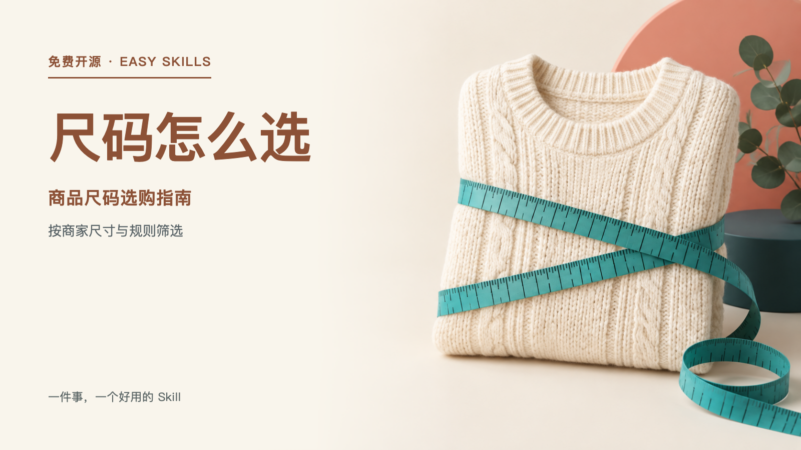

# Shop Size Selection Guide

Turn a merchant-confirmed size chart, measurement method, unit, body area, and selection rules into checkable size guidance. It preserves all confirmed chart dimensions, normalizes units, and can report eligible sizes for up to five named customer measurement groups. A rule that does not match the stated method or body area stops recommendations; height and weight alone never establish fit.



```bash
npx skills add xxjrq/shop-size-selection-guide-cn
node scripts/self-test.mjs
```

For one product only: up to 20 sizes and five customer measurement sets. It does not promise fit or modify SKUs/inventory. See the [success fixture](fixtures/success.json) and [insufficient-data fixture](fixtures/failure.json).
